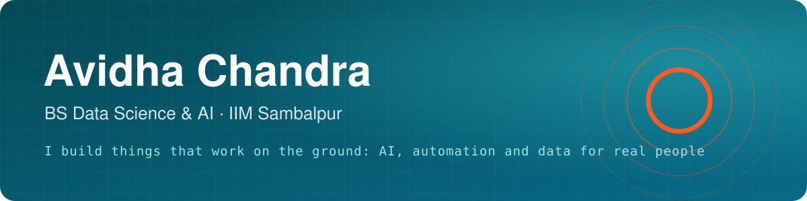

## Hi, I'm Avidha

I'm a second-year **BS Data Science & AI** student at **IIM Sambalpur**. I like building things that work outside the classroom: local AI assistants, automation that saves real people time, and prototypes for social problems I've seen first-hand.

- Currently building with **local LLMs, browser sensors and data pipelines**
- Exploring data analytics, product management and consulting
- Member of IIM Sambalpur's **Career and Skill Development Committee** (placements)

## Featured projects

| Project | What it is | Built with |
|---|---|---|
| **[J.A.R.V.I.S. HUD](https://github.com/Avidha-047/jarvis-hud)** | A private, voice- and gesture-controlled AI assistant that runs fully on my laptop, plus a benchmark of two local models (83% vs 79% accuracy, 1.68 s vs 1.27 s median latency). | OpenJarvis · Ollama (Qwen 3.5) · faster-whisper · MediaPipe · Three.js |
| **[SafeStep](https://github.com/Avidha-047/safestep)** | An AI-enabled smart insole that sends an SOS even when your phone can't. Working prototype with real tap and fall detection, GPS and a live campus dashboard. [Try it live →](https://superb-dodol-78b5ea.netlify.app) | JavaScript · Device Motion & Geolocation APIs · Leaflet · ESP32 / TinyML (planned) |
| **[Norway Company Facts Agent](https://github.com/Avidha-047/norway-company-agent)** | Give it a Norwegian organisation number and it returns a verified company profile where every fact has a source link, a date and a matching explanation. $0 external API cost. | Python (standard library only) · public registers |

## Experience

- **CRY (Child Rights and You)**, Operations Intern: automated donor-reporting reminders with **24 Power Automate flows** across SharePoint and Teams.
- **Youth4Water Plus**, Project Intern, WASH Entrepreneurship: designed **Swasthya Sakhi**, a women-led hygiene enterprise model for rural Odisha.
- **SAIL, Bokaro Steel City**, Vocational Trainee: Communication Networks & IT Department.

## Programs & certifications

- **McKinsey.org Forward** program (2026)
- **Certified GenAI Product Management Professional** (CGENAI-PMP), KOED (2026)
- 1st prize, elocution contest organised by Mahanadi Coalfields Limited

## Skills

**Languages:** English, Hindi

## Find me

